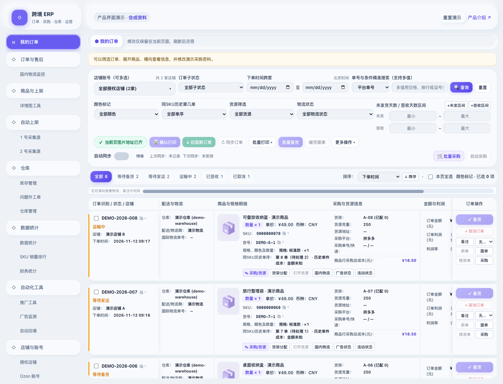

# 跨境 ERP · 产品介绍与界面演示

面向 Ozon 跨境业务的订单、采购、仓库与运营工作台。这里公开产品说明和独立的浏览器演示；完整产品核心源代码保存在私有仓库。

[打开界面演示](https://2529437553.github.io/ozon-erp-showcase/demo.html) · [查看产品介绍](https://2529437553.github.io/ozon-erp-showcase/)

## 可以体验

- 按店铺、订单状态或单号筛选虚构订单。
- 展开多商品，横向滑动查看后续信息。
- 在弹窗中编辑采购资料、保存并再次修改。
- 标记演示订单；一键恢复初始数据。

演示运行在浏览器内，不需要账户，不连接 Ozon 或任何业务服务，不上传输入。修改只保留在当前页面。建议在电脑浏览器打开。

## 产品方向与交付边界

完整产品围绕订单履约、采购、物流、收藏、价格表与活动运营组织工作；按客户实例隔离数据、配置、域名和工具配对，并复用共同产品代码进行维护。

当前是产品预览和商业交付准备阶段，尚未开放付款或正式交付。核心权利关系、Windows 助手、Excel/WPS、真实平台兼容、部署环境及客户使用验收仍需完成对应确认。公开演示不代表这些范围已验收，也不包含真实店铺、生产密钥或客户记录。

GitHub 用于展示项目和管理代码，交易与交付安排另行确定。此仓库没有开放完整产品源代码，也没有授予完整产品的再分发或销售许可。依赖许可见 [第三方声明](docs/THIRD-PARTY-NOTICES.txt)。浏览器演示脚本是公开的展示代码，不包含私有服务端和实际平台执行逻辑。

## 离线查看

下载仓库后，在仓库目录执行 `python3 -m http.server 8080 --directory docs --bind 127.0.0.1`，打开 `http://127.0.0.1:8080/`。无需安装产品后端或导入账号。

不隶属于 Ozon，文中提到的平台名称仅说明适用业务场景。
